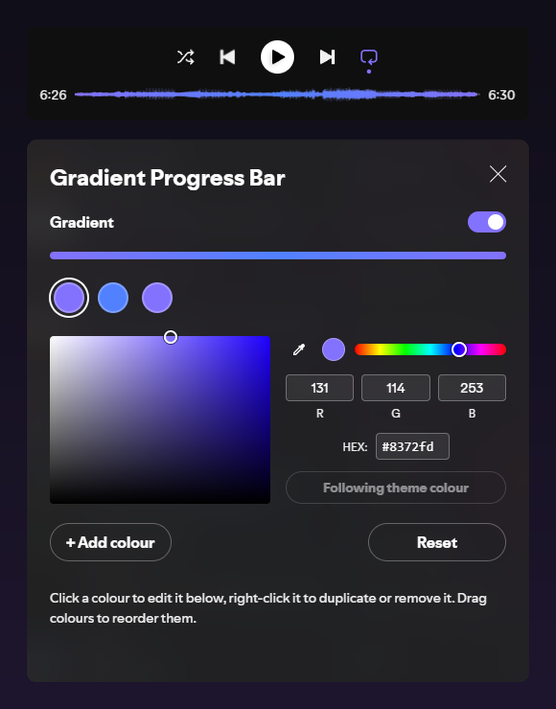

# Gradient Progress Bar

A [Spicetify](https://spicetify.app) extension that recolours Spotify's song progress bar — one colour, or several blended into a gradient.

> **Status:** released — **v1.4.0**. See the [changelog](CHANGELOG.md) and the [roadmap](ROADMAP.md).



## Features

- **Solid colour or gradient** — start with one colour; add more and the bar becomes a gradient automatically. The gradient always runs from the start of the bar to the playhead, so it looks balanced at any point in the song.
- **Three ways to spread a gradient** — *Compress* fits the whole gradient between the start and the playhead, *Anchored* keeps the colours fixed to the bar and reveals them as the song plays, *Slide* moves a full-length gradient in with the playhead.
- **Up to 8 colours**, edited in a built-in colour picker with R/G/B and hex input, reorderable by drag-and-drop.
- **Theme colour stop** — a colour that follows your theme's accent instead of a fixed value. With themes that change their accent per song (like Hazy's album-art mode), the bar follows along.
- **Live preview** — changes show on the bar as you pick.
- **Leaves everything else alone** — only the song progress bar changes; the volume slider, layout and your theme's other styling stay as they are. With default settings the extension changes nothing at all.

## Installation

**Spicetify Marketplace:** search for **Gradient Progress Bar** and click *Install*.

**Manual:**

1. Download `gradientProgressBar.js` from the [latest release](https://github.com/VoidCrowned/spicetify-gradient-progress-bar/releases/latest).
2. Copy it into the `Extensions` folder inside your Spicetify config folder (`spicetify config-dir` shows where), then enable it:
   ```sh
   spicetify config extensions gradientProgressBar.js
   spicetify apply
   ```

To uninstall: `spicetify config extensions gradientProgressBar.js-` then `spicetify apply`.

## Usage

**Right-click the song progress bar** to open the settings. Where Spicetify supports it, there's also a profile-menu entry and a top-bar button, both with a **brush icon** (a brush over a progress bar; see [Troubleshooting](#troubleshooting)).

- **Click a colour dot** to select it (it gets a ring) and edit it in the colour picker below the dots: drag in the square and the hue bar, use the eyedropper (where available), or type R/G/B values or a **hex code** (`#8372fd`, `8372fd` or `#87f`). Changes show on the bar as you go. With the keyboard, Enter or Space on a dot selects it and jumps to the hex field.
- **Use theme colour** in the picker makes the selected colour follow your theme's accent; the button then reads *Following theme colour*. Hover a dot to see whether it's a theme colour.
- **Right-click a dot** for **Duplicate** and **Remove** (also with the context-menu key or Shift+F10).
- **Gradient** switches the gradient on and off. With only one colour, switching it on adds a second colour (a copy of the first) for you to change.
- **− | +** (the pill after the dots): **+** adds another colour, a copy of the last one, and selects it; with two or more, gradient mode switches on. Up to 8 colours. **−** removes the selected colour (the one with the ring); at least one colour always stays.
- **Delete** or **Backspace** on a colour dot you've tabbed to removes that colour.
- **Spread** (below the Gradient switch) picks how the gradient covers the bar: *Compress*, *Anchored* or *Slide*. The line below the buttons describes the active one.
- **Drag the dots** to reorder the gradient. With the keyboard, Alt + arrow keys move the focused colour (Alt + Home / End to the first or last place).
- **Reset** (centred below the picker) goes back to the default: a single colour that follows your theme, no gradient. It asks for a second click to confirm: the button turns red and reads *Confirm reset?* for 3 seconds; waiting, pressing Escape or clicking anything else cancels.

## Compatibility

Designed to sit on top of any theme without fighting it: it uses no `!important`, never changes the bar's size or shape, and only targets the song progress bar. Tested with:

| | Notes |
|---|---|
| [Hazy](https://github.com/Astromations/Hazy) | The theme colour stop follows Hazy's accent — whether that's the album-art colour or your *Custom color*. |
| [playback-bar-waveform](https://github.com/Konsl/spicetify-extensions) | The gradient is drawn inside the waveform shape. |

## Troubleshooting

- **Profile menu won't open, or the menu entry is missing, on Spotify 1.3.4 with Spicetify 2.45.3:** that's a Spicetify bug, not this extension ([spicetify/cli#4012](https://github.com/spicetify/cli/issues/4012)). With any Spicetify entry in the profile menu, the menu fails to open. This extension hides its entry on purpose while that bug is present, so it never breaks your menu; the entry appears by itself once Spicetify is fixed. Meanwhile, right-click the song progress bar to open the settings ([#27](https://github.com/VoidCrowned/spicetify-gradient-progress-bar/issues/27)). If the menu still won't open, another extension's entry is the cause.
- **No top-bar button:** on Spotify 1.3.4 / Spicetify 2.45.3 Spicetify's top-bar buttons never appear (fixed in Spicetify, coming with its next release, [#38](https://github.com/VoidCrowned/spicetify-gradient-progress-bar/issues/38)). Right-click the song progress bar instead.
- **After a Spotify update the bar is back to normal:** updates remove Spicetify's patch. Run `spicetify apply`, or `spicetify backup apply` if Spicetify asks for it.
- **The bar keeps the theme colour although you set colours:** with the gradient off, only the first colour counts. If that one follows the theme, the extension deliberately leaves the bar alone. Click it and pick a colour, or switch the gradient on.
- **Something looks wrong with your theme or another extension:** [open an issue](https://github.com/VoidCrowned/spicetify-gradient-progress-bar/issues/new/choose) and follow [CONTRIBUTING.md → Reporting a bug](CONTRIBUTING.md#reporting-a-bug).

## Roadmap

See [ROADMAP.md](ROADMAP.md) and the [changelog](CHANGELOG.md).

## Contributing

Bug reports and pull requests are welcome; see [CONTRIBUTING.md](CONTRIBUTING.md) and [TESTING.md](TESTING.md).

## Credits

- [Spicetify](https://spicetify.app)
- [Hazy](https://github.com/Astromations/Hazy) by Astromations and [playback-bar-waveform](https://github.com/Konsl/spicetify-extensions) by Konsl — the setups this was built and tested against.

## Licence

Copyright © 2026 VoidCrowned. This program is free software. It comes without any warranty, to the extent permitted by applicable law. You can redistribute it and/or modify it under the terms of the Do What The Fuck You Want To Public License, Version 2, as published by Sam Hocevar. See [LICENSE](LICENSE) or http://www.wtfpl.net/ for more details.
